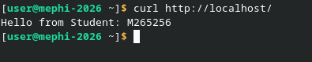

# Сессионный проект: Настройка базовых средств защиты ОС GNU/Linux (РЕД ОС 8)

* **Студент:** М265256
* **Хост:** `mephi-2026.domain.local`
* **ОС:** РЕД ОС 8 (сертификат ФСТЭК России №4060)

---

## Подтверждение работы веб-сервера

Скриншот выполнения контрольного запроса к веб-серверу `nginx`:



---

## Таблица выполнения заданий

| Раздел | Пункт задания | Описание выполненных действий и настроек | Артефакт / Конфигурация | Скриншот выполнения |
| :--- | :--- | :--- | :--- | :---: |
| **1. Установка дистрибутива** | 1.1. Настройка сети | Настройка DHCP и автоматического подключения интерфейса через `nmcli`. | `history.out` | [1.1.PNG](1.1.PNG) |
| | 1.2. Имя хоста | Назначение имени хоста `mephi-2026.domain.local` через `hostnamectl`. | `history.out` | [1.2.PNG](1.2.PNG) |
| | 1.3. Связность сети | Проверка сетевого соединения отправкой ICMP-запросов на `8.8.8.8`. | [`ping.out`](ping.out) | [1.3.PNG](1.3.PNG) |
| **2. Управление ПО** | 2.1. Обновление ОС | Полное обновление пакетной базы дистрибутива (`dnf update -y`). | `history.out` | [2.1.PNG](2.1.PNG) |
| | 2.2. Установка пакетов | Установка из репозиториев веб-сервера `nginx` и утилит `libcap-ng-utils`. | `history.out` | [2.2.PNG](2.2.PNG) |
| | 2.3. Локальный RPM | Загрузка пакета `tcpdump` через `dnf download` и установка с помощью `rpm -ivh`. | [`dnf.out`](dnf.out) | [2.3.PNG](2.3.PNG) |
| **3. Файловые системы** | 3.1. Разметка и ФС | Создание таблицы GPT и раздела на диске `/dev/sdb`, форматирование в `ext4` с меткой тома `MEPHI_WEB`. | `history.out` | [3.1.PNG](3.1.PNG) |
| | 3.2. Монтирование | Создание точки `/mephi-web`, добавление записи в `/etc/fstab` по `LABEL=MEPHI_WEB`, монтирование тома. | [`fstab`](fstab) | [3.2.PNG](3.2.PNG) |
| **4. Управление сервисами** | 4.1. Автозапуск Nginx | Добавление службы `nginx` в автозагрузку и ее немедленный запуск (`systemctl enable nginx --now`). | `history.out` | [4.1.PNG](4.1.PNG) |
| | 4.2. Журналирование | Сбор записей системного журнала текущей загрузки для службы Nginx (`journalctl -u nginx -b`). | [`journalctl.out`](journalctl.out) | [4.2.PNG](4.2.PNG) |
| **5. Управление доступом** | 5.1. Модель DAC | Создание каталога `/data/mephi-2026`, настройка пользователей (`user1-3`), кураторов (`curator1-2`), прав доступа и наследования через SGID и POSIX Default ACL. | [`stat.out`](stat.out), [`group`](group) | [5.1.PNG](5.1.PNG) |
| | 5.2. Привилегии (Capabilities) | Назначение возможностей `cap_net_raw,cap_net_admin=eip` утилите `tcpdump` для запуска непривилегированным пользователем. | [`getcap.out`](getcap.out) | [5.2.PNG](5.2.PNG) |
| | 5.3. Модель MAC (SELinux) | Проверка статуса `Enforcing`, назначение контекста безопасности `httpd_sys_content_t` директории `/mephi-web`. | [`getenforce.out`](getenforce.out), [`stat.out`](stat.out) | [5.3.PNG](5.3.PNG) |
| **6. Аутентификация** | 6.1. Ограничение входа | Запрет локального консольного входа для группы `curators` через PAM-модуль `pam_access.so` в `/etc/security/access.conf`. | `history.out` | [6.1.PNG](6.1.PNG) |
| | 6.2. Политика паролей | Установка максимального срока действия паролей в 90 дней (`/etc/login.defs`, `chage`) и минимальной длины в 12 символов (`/etc/security/pwquality.conf`). | [`pwquality.conf`](pwquality.conf), [`shadow`](shadow) | [6.2.PNG](6.2.PNG) |
| **7. Тестирование** | 7.1–7.2. Web-страница | Создание `index.html` с текстом `Hello from Student: М265256` и проверка доступности страницы через `curl`. | [`curl.out`](curl.out) | [7.PNG](7.PNG) |
| **8. Публикация** | 8.1–8.4. GitHub | Экспорт отчетов, журналов, конфигурационных файлов и скриншотов в публичный репозиторий проекта. | [Репозиторий](https://github.com/mimka1987/mephi-session-project-2026) | [mephi-screenshot.PNG](mephi-screenshot.PNG) |

---

## Состав репозитория

```text
├── curl.out              # Ответ веб-сервера на локальный запрос
├── dnf.out               # История транзакций пакетного менеджера DNF
├── fstab                 # Конфигурация монтирования файловых систем
├── getcap.out            # Назначенные capabilities на файл tcpdump
├── getenforce.out        # Статус работы SELinux (Enforcing)
├── group                 # Список локальных групп пользователей
├── history.out           # История выполненных команд
├── journalctl.out        # Журнал работы службы nginx
├── mephi-screenshot.PNG  # Итоговый скриншот проверки curl
├── passwd                # Учетные записи пользователей
├── ping.out              # Проверка внешней сетевой связности
├── pwquality.conf        # Конфигурация сложности паролей
├── shadow                # Параметры устаревания паролей
├── stat.out              # Права доступа (ACL) и контексты SELinux
├── README.md             # Документация и сводная таблица
└── *.PNG                 # Скриншоты подтверждения этапов настройки
